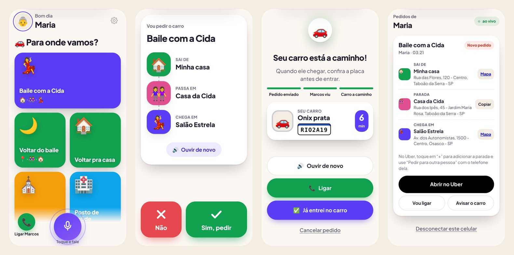

# Me Leva

**Chamar carro sem precisar ler.** Quem não sabe ler escolhe para onde quer ir **tocando numa figura ou falando**, e o **Uber abre no celular dela** já com a saída e a chegada prontas. Um familiar acompanha e manda os dados do carro, e o app **fala** o modelo, a cor, a placa e em quantos minutos ele chega.

Também dá para usar o modo antigo, em que o pedido vai para o familiar e **ele** chama o carro (Ajustes → “Como chamar o carro”).

🔗 **Demonstração:** https://marcos7ut.github.io/me-leva/ (toque em “Ver demonstração”)



---

## Por que existe

Minha mãe e uma amiga dela não leem, e saem para bailes. Toda vez alguém da família precisava chamar o carro por elas, muitas vezes com uma parada no caminho: pegar minha mãe em casa, passar na casa da amiga e seguir para o salão. O Me Leva transforma isso em **um toque**: ela escolhe a figura, confirma no botão verde, e eu recebo o pedido pronto no celular.

## Como funciona

```
 Celular da mãe                          Celular do filho
 ──────────────                          ────────────────
 toca na figura ou fala  ─── pedido ───▶  notificação com o caminho
 “quero ir pro baile”        (ntfy)        [Abrir no Uber] já preenchido
 confirma no ✅ verde                       adiciona a parada e chama
                         ◀── resposta ──  “Onix prata, RIO2A19, 6 min”
 o app FALA o carro                         
 [Já entrei no carro] ─────────────────▶  “Entrou no carro ✅”
```

### Para quem usa (sem ler nada)
- **Um botão por lugar** (até 30 na tela), com figura, cor e foto do lugar ou da pessoa: tocou, confirmou no verde, o **Uber abre** com a saída (onde ela está) e a chegada preenchidas
- Ao voltar do Uber, o app **lembra falando** o que fazer e tem o botão **Abrir o Uber** de novo
- **Comando de voz**: “quero ir pro baile”, “me leva na Cida”, “quero voltar pra casa”, “liga pro Marcos”
- **Tudo é falado**: o caminho antes de confirmar, o andamento do pedido e os dados do carro, com a **placa soletrada**
- Só dois botões para decidir: **✅ verde** e **✕ vermelho**
- Botão grande de **ligar para o filho** sempre na tela
- “Onde ela estiver”: para a volta do baile, o app manda a localização do GPS

### Para quem recebe
- Notificação no Android pelo app gratuito **ntfy**, com o botão **Abrir no Uber** (saída e chegada já preenchidas)
- Paradas no meio com botão **Copiar** endereço, e links para o mapa
- Respostas rápidas: **Vou ligar** ou **Avisar o carro** (modelo, cor, placa e minutos)
- Fica sabendo quando ela **cancelou** ou **entrou no carro**

### Para quem configura
- Ajustes protegidos: **segurar a engrenagem por 2 s + senha de 4 números**, para ninguém mudar nada sem querer
- **Como chamar o carro**: abrir o Uber no celular dela (padrão) ou avisar a família para chamar
- Até **40 lugares** com busca de endereço (OpenStreetMap), **“Estou neste lugar agora”** pelo GPS e prévia no mapa; cada lugar novo **já vira um botão** na tela dela
- **Ponto de embarque da casa**: marque um lugar como “a casa dela” e ajuste o pino tocando no mapa (ex.: a entrada da viela). Se ela estiver a até 200 m de casa, o Uber abre com a saída nesse ponto marcado; fora de casa, usa o GPS
- Ordem dos botões ajustável (↑ ↓)
- Atalhos com até 4 pontos: saída, 2 paradas e chegada (no modo Uber, as paradas do meio são adicionadas no próprio Uber)
- “Outras palavras para a voz”: apelidos que ela usa para cada lugar
- Conectar o celular do filho por **um link enviado no WhatsApp**

## Decisões técnicas

| | |
|---|---|
| **Sem servidor próprio** | Os dados ficam no `localStorage` do celular. Os pedidos trafegam pelo [ntfy.sh](https://ntfy.sh) (gratuito), num canal com nome aleatório de 24 caracteres criado em cada instalação. |
| **Integração com o Uber** | A API que pede corridas é restrita a parceiros aprovados pela Uber, então o app usa os **links universais** (`m.uber.com/ul`), que abrem o Uber com saída e chegada preenchidas. O link é aberto direto no toque dela, para o Android abrir o aplicativo do Uber e não o site. Os dados do carro chegam pelo familiar (ex.: pelo Perfil Família do Uber), porque o app não tem como ler a tela do Uber. |
| **Voz** | Web Speech API: reconhecimento em pt-BR (Chrome no Android) e fala com a voz do próprio celular. O entendimento compara as palavras ditas com os nomes e apelidos dos lugares e dá mais peso ao destino. |
| **Acessibilidade** | Alvos de toque de 64 a 120 px, alto contraste, tema escuro, respeito a “reduzir movimento”, e todo conteúdo importante também falado. |
| **PWA** | Instala na tela inicial e abre sem internet (service worker). |
| **Segurança** | O conteúdo recebido pela internet é montado com `textContent` (sem `innerHTML`) e a tela de ajustes é protegida por senha. |

**Tecnologias:** HTML, CSS e JavaScript puro (sem framework e sem build), Web Speech API, Geolocation API, Service Worker, ntfy, OpenStreetMap/Nominatim, links universais da Uber.

## Rodar no computador

```bash
python3 -m http.server 8000
# abra http://localhost:8000
```

## Privacidade

- Nada é enviado a servidor do projeto: não existe servidor do projeto.
- Os pedidos passam pelo ntfy.sh e ficam guardados lá por até 12 horas. Quem souber o nome do canal consegue ler, por isso ele é aleatório e longo. Para mais privacidade, dá para usar um servidor ntfy próprio definindo `window.ME_LEVA_NTFY`.
- Endereços são buscados no Nominatim (OpenStreetMap) só na hora de cadastrar os lugares.

---

Desenvolvido por **Marcos Antonio de Lima Junior** · [github.com/marcos7ut](https://github.com/marcos7ut)
